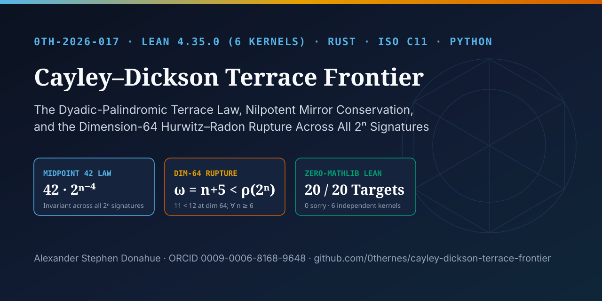

# Cayley–Dickson Terrace Frontier (`0TH-2026-019`)

[](https://github.com/0thernes/cayley-dickson-terrace-frontier/actions/workflows/ci.yml)
[-0072B2)](lean/formalization.yaml)
[](REUSE.toml)
[](https://0thernes.github.io/cayley-dickson-terrace-frontier/)

**The Dyadic-Palindromic Terrace Law, Nilpotent Mirror Conservation, and Coordinate Norm-Multiplicativity Ruptures Across Cayley–Dickson Algebras (`v2.0.0`)**

*Author:* **Alexander Stephen Donahue** (Independent Researcher, Spokane, WA, USA · ORCID [`0009-0006-8168-9648`](https://orcid.org/0009-0006-8168-9648) · `0_0@0thernes.art`)  
*Maintenance status:* **Active (`v2.0.0`)** — resolves every manuscript, formal Lean, and tooling entry logged in [`ERRATA.md`](ERRATA.md) against `v1.0.0`, formalizes the exact $2 \times 2$ block linear-algebra kernel-basis isomorphism (`T1f`), proves the Pathion ceiling $r_{\max}(\mathrm{CD}_5) = 14$ with strict $7 + 7$ half-balance rigidity in pure Lean across all $2^{32}$ subsets retiring external MILP solvers (`T4e`), and certifies the dimension-64 split interior spectral gap $H_6^{56}(20) = 0$ in pure Lean (`T4f`).



---

## Summary

This repository contains a **zero-Mathlib Lean 4.35.0 formalization** (**22 headline theorems `T1a`–`T4f`**, **23 Palomar Comparator targets**, **4 non-vacuity witnesses**, **8 adversarial boundary refutations**, and **35 axiom-audited declarations**), independent differential checkers in **Rust** (`#![forbid(unsafe_code)]`), **strict ISO C11** (`-Werror -Wconversion -Wshadow`, ASan/UBSan, 100k + libFuzzer fuzzing across all 496 algebras with zero stride), and **Python** (naive recursive $\mathbb{Q}$ Gaussian elimination oracle, Hypothesis property tests, and surgical mutation suite), a zero-CDN WCAG 2.2 AA **interactive 3D Canvas observatory** and **Proof Dependency Blueprint**, cryptographic **DigiCert RFC 3161 (`.tsr`)** and **Bitcoin OpenTimestamps (`.ots`)** proofs, and a 21-page zero-warning AMS-LaTeX white paper.

### Scope of the Lean Statements (`v2.0.0`)

- **Literal Bilinear Algebra Inside Lean (`T1c`, `T1f`):** `CDTerrace.Basic` defines the literal bilinear Cayley–Dickson product `cdMulCoordGamma`. Theorem `T1c` proves both cross-term cancellation $\sigma_n^\gamma(i,j) + \sigma_n^\gamma(j,i) = 0$ and full coordinate-wise nilpotency $((e_i+e_j)^2)_t = 0$. Theorem `T1f` (`twoblade_left_annihilator_basis_exact`) formally proves in Lean that the block-count nullity `twobladeNullityGamma` equals the exact cardinality of an explicit 2-sparse linearly independent spanning $\mathbb{Z}$-basis of $\ker L_{e_i + e_j}$ across all $n \ge 1$ and all $2^n$ signatures $\gamma$.
- **Signature & Subspace Scope:** Pillar 1 (`T1a`–`T1f`), the midpoint law (`T2f`), and the split-phase theorems (`T4c`, `T4f`) hold for generalized signatures $\gamma \in \{\pm 1\}^n$. Theorems `T2a`–`T2e`, Pillar 3 (`T3a`–`T3d`), and `T4a`, `T4b`, `T4d`, `T4e` concern **Euclidean $\mathrm{CD}_n$ coordinate subsets**. Nothing is claimed about non-coordinate subspaces or general real sums-of-squares formulas.
- **Verification Tiers:**
  - `[LEAN-6K]`: Machine-checked in zero-Mathlib Lean 4.35.0 (`lake build`, `leanchecker --fresh`, `leanchecker-paranoid --fresh`), audited via `VerifyAxioms.lean` strictly within `{propext, Classical.choice, Quot.sound}` (0 `sorry`, 0 `admit`, 0 `native_decide`, 0 `maxRecDepth`/`maxHeartbeats` overrides), and replayed in CI across **6 independent kernels** (`lean`, `leanchecker-paranoid`, `lean4lean`, `nanoda`, `con-leche`, `con-ron`) via `lake check --paranoid` and `lake comparator --config comparator.json --paranoid`.
  - `[EXACT-COMP]`: Verified with exact integer/rational arithmetic outside Lean (Rust, ISO C11, Python).
- **Prior Work Credit:** $4 \mid \nu$ is the 2-blade case of Moreno's multiple-of-four theorem (cf. Moreno 1998; Biss–Dugger–Isaksen 2008); the 42 sedenion assessors and 7 box-kites ($7 \times K_{2,2,2}$) are due to de Marrais (2000, 2002); cochain presentations of Cayley–Dickson algebras appear in Albuquerque–Majid (1999) and Morier-Genoud–Ovsienko (2011); Moreno (2004) studies alternative elements; Zhilina (2021, Parts I–II) studies orthogonality graphs of real Cayley–Dickson algebras including basis-pair zero divisors.

### Principal Results

1. **Pillar 1 — Nilpotent Mirror Conservation & Exact Kernel Basis (`T1a`–`T1f`, `[LEAN-6K]`, all $n$, all $\gamma$):**
   - Multiplicative cocycle factorization $\sigma_n^\gamma(i,j) = \sigma_n^{\mathrm{std}}(i,j)\,(-1)^{\mathrm{popcount}(i\,\&\,j\,\&\,\mathrm{flip}(\gamma))}$ and $k$-independent $2\times 2$ block-sign flip $\delta_n^\gamma(i,j,k) = \chi_n((i\oplus j)\,\&\,\mathrm{flip}(\gamma))\,\delta_n^{\mathrm{std}}(i,j,k)$.
   - Full bilinear 2-blade nilpotency (`T1c`), Nilpotent Mirror Inversion (`T1d`), Mirror-Pair Conservation & Midpoint Invariance (`T1e`), and the exact $2\times 2$ block linearly independent spanning $\mathbb{Z}$-basis isomorphism for $\ker L_{e_i+e_j}$ (`T1f`).
2. **Pillar 2 — The Dyadic-Palindromic Terrace Law & Sharp BDI Separation (`T2a`–`T2f`, `[LEAN-6K]`):**
   - Four-branch Euclidean 2-blade doubling recurrence (`T2a`), closed-form mass $M_n = 8(2^{n-1}-1)(2^{n-2}-1)(2^{n-3}-1)$ and nullity-zero count $H_n^{\mathrm{std}}(0) = (6n-9)2^{n-2}+3$ (`T2c`), exact even/odd bin interleaving and interior palindrome (`T2d`), exact top bin $2H_n(0)$ and top-bin jump $+3(2^n-2)$ (`T2e`), and the universal all-signature midpoint law $H_n^\gamma(2^{n-2}) = 42 \cdot 2^{n-4}$ for all $n \ge 4$ and all $2^n$ signatures (`T2f`).
   - Independent 2-blade proof of Moreno's $4 \mid \nu_n^{\mathrm{std}}$, explicit attainment of the ceiling $2^{n-1}-4$ at $e_1 + e_{2 + 2^{n-1}}$, exact equivalence $2^{n-1}-4 = 2^n - 4n + 4 \iff n = 4$ among $n \ge 4$, and strict separation below the classical Biss–Dugger–Isaksen formula for all $n \ge 5$ (`T2b`).
3. **Pillar 3 — Euclidean Coordinate Right-Multiplier Rupture at Dimension 64 (`T3a`–`T3d`, `[LEAN-6K]`):**
   - Doubling law of $G_n^{\mathrm{comp}}$, unique universal right-multipliers $\{e_0, e_{2^{n-1}}\}$ for $n \ge 4$ (`T3a`), exact clique number $\omega(G_n^{\mathrm{comp}}) = n + 5$ for $n \ge 3$ (`T3b`), arithmetic comparison against $\rho(2^n) = 8\lfloor n/4\rfloor + 2^{n \bmod 4}$ matching at $n \in \{3,4,5\}$ and falling short by $\ge n - 5$ for all $n \ge 6$ (`T3c`), and constructive $[2^n, n+5, 2^n]$ and $[2^{n-1}, 2(n+4), 2^n]$ coordinate pairs (`T3d`).
4. **Pillar 4 — Sedenion Triple-42, Pure-Kernel Pathion Ceiling 14 ($7+7$ Rigidity), & Dim-64 Gap (`T4a`–`T4f` `[LEAN-6K]`; `C1`, `C2` `[EXACT-COMP]`):**
   - All $2^{16}$ sedenion coordinate subsets: 42 bad affine 2-planes (all proved strictly $2+2$ split in Lean), 42 maximal 10D norm-multiplicative subspaces with Fano split $7+28+7=42$, and zero of dimension $\ge 11$ (`T4a`).
   - Pure vanishing-product re-verification of de Marrais's $7 \times K_{2,2,2}$ box-kites (zero XOR pre-filtering) and 9D $\mathbb{O} \oplus \mathbb{R} e_8$ (`T4b`).
   - Split-phase classifications of $\mathrm{CD}_4(\gamma)$ ($1{:}1{:}7{:}7$) and $\mathrm{CD}_5(\gamma)$ ($4{\times}1+4{\times}7$) (`T4c`), $[14,14,32]$ and $[16,16,64]$ witnesses plus ring-axiom-derived unit-square lemma $c^2=1 \implies c = \pm 1$ (`T4d`).
   - **Pure-Kernel Pathion Ceiling & $7+7$ Rigidity (`T4e`, `[LEAN-6K]`):** Over all $2^{32} = 4{,}294{,}967{,}296$ coordinate subsets of $\mathrm{CD}_5$, universal all-$n$ half-swap symmetry plus a zero-backtracking greedy clique-cover certificate proves $r_{\max}(\mathrm{CD}_5) = 14$ (retiring external MILP solvers from the proof trust base) and strict $7+7$ half-balance rigidity ($|S|=14 \implies |S_{\mathrm{lo}}|=7 \land |S_{\mathrm{hi}}|=7$). Exhaustive Rust/Python branch-and-bound (`C2`, `[EXACT-COMP]`) counts exactly **280** 14D subspaces (100% $7+7$, 100% containing $\{e_0, e_{16}\}$).
   - **Dimension-64 Split Interior Spectral Gap (`T4f`, `[LEAN-6K]`):** Complete 9-bin kernel proof at $\mathrm{CD}_6(\mathrm{flip}=56)$: `{0: 257, 4: 422, 8: 364, 12: 336, 16: 168, 20: 0, 24: 56, 28: 172, 32: 178}`, certifying $H_6^{56}(20) = 0$. Complete 448-algebra split tables for $\mathrm{CD}_6$–$\mathrm{CD}_8$ are verified in Rust, C11, and Python (`C1`, `[EXACT-COMP]`).

> **Explore Live:** Open the zero-CDN WCAG 2.2 AA **interactive 3D Canvas Box-Kite & Terrace Observatory** at **[0thernes.github.io/cayley-dickson-terrace-frontier](https://0thernes.github.io/cayley-dickson-terrace-frontier/)** or the synchronized 26-node [Proof Dependency Blueprint](https://0thernes.github.io/cayley-dickson-terrace-frontier/blueprint.html).

---

## Quickstart & Usage Examples

### 1. Verify All 23 Lean 4.35.0 Palomar Targets & 35-Declaration Axiom Audit
```bash
cd lean
lake build
lake build PalomarChallenge
lake env lean VerifyAxioms.lean
lake env leanchecker --fresh PalomarSolution
lake env leanchecker-paranoid --fresh PalomarSolution
```

### 2. Exhaustive 496-Algebra & 280-Pathion-Subspace Audit in Rust
```bash
cd rust
cargo clippy --all-targets -- -D warnings
cargo test --release
cargo run --release -- --verify-all
```

### 3. Strict ISO C11 Engine, Sanitizers (ASan/UBSan) & 100k Fuzzing
```bash
cd c
make clean test sanitize fuzz
./build/fuzz_cd_terrace 100000
./build/cd_terrace_cli --verify-all
```

### 4. Python Exact $\mathbb{Q}$ Oracle, Hypothesis, Mutation, Citation & Timestamp Checks
```bash
PYTHONPATH=src:. python examples/quickstart_demo.py
PYTHONPATH=src:. pytest -v tests/test_all.py
python scripts/check_readme_axioms.py
python scripts/check_citations.py --live
python scripts/stamp_timestamps.py --verify --negative-test
```

### 5. End-to-End Clean-Clone Reproduction
```bash
just reproduce
```

---

## Verbatim Lean 4.35.0 Kernel Axiom Audit (`results/lean_axioms.txt`)

Every one of the 23 Palomar Comparator headline targets (`T1a`–`T4f` + master conjunction), 4 pillar non-vacuity witnesses, and 8 adversarial boundary refutations (**35 declarations total**) depends **exclusively** on a subset of `{propext, Classical.choice, Quot.sound}` — zero `sorryAx`, zero `Lean.ofReduceBool`, zero `native_decide`, zero custom axioms:

```text
'CDTerrace.Palomar.prove_t1a' depends on axioms: [propext, Classical.choice, Quot.sound]
'CDTerrace.Palomar.prove_t1b' depends on axioms: [propext, Classical.choice, Quot.sound]
'CDTerrace.Palomar.prove_t1c' depends on axioms: [propext, Classical.choice, Quot.sound]
'CDTerrace.Palomar.prove_t1d' depends on axioms: [propext, Classical.choice, Quot.sound]
'CDTerrace.Palomar.prove_t1e' depends on axioms: [propext, Classical.choice, Quot.sound]
'CDTerrace.Palomar.prove_t1f' depends on axioms: [propext, Classical.choice, Quot.sound]
'CDTerrace.Palomar.prove_t2a' depends on axioms: [propext, Classical.choice, Quot.sound]
'CDTerrace.Palomar.prove_t2b' depends on axioms: [propext, Classical.choice, Quot.sound]
'CDTerrace.Palomar.prove_t2c' depends on axioms: [propext, Classical.choice, Quot.sound]
'CDTerrace.Palomar.prove_t2d' depends on axioms: [propext, Classical.choice, Quot.sound]
'CDTerrace.Palomar.prove_t2e' depends on axioms: [propext, Classical.choice, Quot.sound]
'CDTerrace.Palomar.prove_t2f' depends on axioms: [propext, Classical.choice, Quot.sound]
'CDTerrace.Palomar.prove_t3a' depends on axioms: [propext, Classical.choice, Quot.sound]
'CDTerrace.Palomar.prove_t3b' depends on axioms: [propext, Classical.choice, Quot.sound]
'CDTerrace.Palomar.prove_t3c' depends on axioms: [propext, Classical.choice, Quot.sound]
'CDTerrace.Palomar.prove_t3d' depends on axioms: [propext, Classical.choice, Quot.sound]
'CDTerrace.Palomar.prove_t4a' depends on axioms: [propext, Classical.choice, Quot.sound]
'CDTerrace.Palomar.prove_t4b' depends on axioms: [propext, Classical.choice, Quot.sound]
'CDTerrace.Palomar.prove_t4c' depends on axioms: [propext, Classical.choice, Quot.sound]
'CDTerrace.Palomar.prove_t4d' depends on axioms: [propext, Classical.choice, Quot.sound]
'CDTerrace.Palomar.prove_t4e' depends on axioms: [propext, Classical.choice, Quot.sound]
'CDTerrace.Palomar.prove_t4f' depends on axioms: [propext, Classical.choice, Quot.sound]
'CDTerrace.Palomar.prove_all_terrace_theorems' depends on axioms: [propext, Classical.choice, Quot.sound]
'CDTerrace.nonvacuity_pillar1_split_sedenion' depends on axioms: [propext, Classical.choice, Quot.sound]
'CDTerrace.nonvacuity_pillar2_terrace_instances' depends on axioms: [propext, Classical.choice, Quot.sound]
'CDTerrace.nonvacuity_pillar3_dim64_rupture' depends on axioms: [propext, Classical.choice, Quot.sound]
'CDTerrace.nonvacuity_pillar4_witnesses' depends on axioms: [propext, Classical.choice, Quot.sound]
'CDTerrace.refute_hurwitz_saturation_at_64' depends on axioms: [propext, Classical.choice, Quot.sound]
'CDTerrace.refute_sedenion_11d_coord_subspace' depends on axioms: [propext, Classical.choice, Quot.sound]
'CDTerrace.refute_twoblade_reaches_bdi_at_64' does not depend on any axioms
'CDTerrace.refute_split_preserves_individual_bins' depends on axioms: [propext, Classical.choice, Quot.sound]
'CDTerrace.refute_third_universal_multiplier' depends on axioms: [propext, Classical.choice, Quot.sound]
'CDTerrace.refute_gaussian_imaginary_intercalate' depends on axioms: [propext, Quot.sound]
'CDTerrace.refute_pathion_15d_or_unbalanced_14d' depends on axioms: [propext, Classical.choice, Quot.sound]
'CDTerrace.refute_cd6_split56_contiguous_bins' depends on axioms: [propext, Classical.choice, Quot.sound]
```

---

## Repository Map

| Path | Description |
| --- | --- |
| [`lean/`](lean/) | Zero-Mathlib Lean 4.35.0 proof suite (8 modules including `PathionRupture.lean`, 23 Palomar targets, 35 audited decls) |
| [`rust/`](rust/) | Zero-dependency `#![forbid(unsafe_code)]` Rust engine auditing all 496 algebras $\mathrm{CD}_4$–$\mathrm{CD}_8$ + exact 280 Pathion 14D subspaces |
| [`c/`](c/) | Strict ISO C11 (`-Wall -Wextra -Wpedantic -Werror -Wshadow -Wconversion`) verifier, ASan/UBSan, 100k + libFuzzer, all 496 algebras zero-stride |
| [`src/cd_terrace/`](src/cd_terrace/) & [`reference/`](reference/) | Exact Python engine + independent naive recursive / exact $\mathbb{Q}$ Gaussian elimination oracle |
| [`paper/`](paper/) & [`dist/`](dist/) | 21-page zero-warning AMS-LaTeX white paper (`v2.0.0`), 5 Okabe-Ito vector figures, 30 BibTeX entries (28/30 live Crossref/arXiv title+author+year+retraction verified + 2 print-only classics), frozen PDF & clean-room `arxiv_submission.tar.gz` |
| [`docs/site/`](docs/site/) | Zero-CDN WCAG 2.2 AA interactive 3D Canvas Observatory (`index.html`) + synchronized 26-node Proof Blueprint (`blueprint.html`) |
| [`data/`](data/) & [`results/`](results/) | Frozen JSON certificates, `data/MANIFEST.sha256`, DigiCert RFC 3161 `.tsr`, Bitcoin `.ots`, and `results/lean_axioms.txt` |
| [`CLAIMS.md`](CLAIMS.md), [`LIMITATIONS.md`](LIMITATIONS.md), [`ERRATA.md`](ERRATA.md) | Granular claim ledger, explicit epistemic boundaries, and full resolution log of all 23 v1.0.0 errata |

---

## Citation & Licensing

- **Code** (`lean/`, `rust/`, `c/`, `src/`, `reference/`, `tests/`, `scripts/`, `examples/`): **Apache-2.0** ([`LICENSE`](LICENSE)).
- **Paper, Figures, Data & Documentation** (`paper/`, `dist/`, `docs/`, `data/`, `*.md`): **CC-BY-4.0** ([`LICENSE-DOCS`](LICENSE-DOCS)).
- Machine-readable copyright & license coverage declared in [`REUSE.toml`](REUSE.toml) and citation metadata in [`CITATION.cff`](CITATION.cff).
