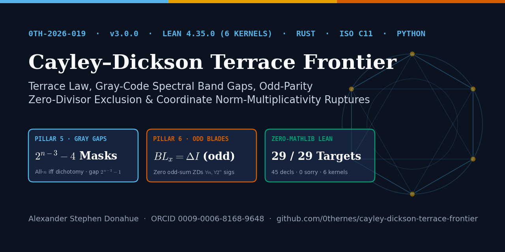

# Cayley–Dickson Terrace Frontier (`0TH-2026-019`)

[](https://github.com/0thernes/cayley-dickson-terrace-frontier/actions/workflows/ci.yml)
[-0072B2)](lean/formalization.yaml)
[](REUSE.toml)
[](https://0thernes.github.io/cayley-dickson-terrace-frontier/)

**The Dyadic-Palindromic Terrace Law, Gray-Code Spectral Band Gaps, Odd-Parity Zero-Divisor Exclusion, and Coordinate Norm-Multiplicativity Ruptures Across Cayley–Dickson Algebras (`v3.0.0`)**

*Author:* **Alexander Stephen Donahue** (Independent Researcher, Spokane, WA, USA · ORCID [`0009-0006-8168-9648`](https://orcid.org/0009-0006-8168-9648) · `0_0@0thernes.art`)  
*Maintenance status:* **Active (`v3.0.0`)** — expands the zero-Mathlib six-kernel Lean 4.35.0 proof suite to **6 pillars / 28 headline theorems (`T1a`–`T6c`) / 29 Palomar Comparator targets / 45 axiom-audited declarations** by proving two new universal all-$n$, all-signature theorem families: **Pillar 5** (Binary Reflected Gray-Code Bit-Locking, Exponential Continuous Spectral Band Gaps of width $2^{n-3}-1$, and the Exact $2^{n-3}-4$ Spectral-Gap Dichotomy `T5a`–`T5c`) and **Pillar 6** (Universal Mod-2 Twisted-Group-Algebra Frobenius Involution, Fraction-Free Odd-Pivot Integral Matrix Inversion, and Odd-Parity / Odd-Support Unit-Blade Zero-Divisor Exclusion `T6a`–`T6c`).



---

## Summary

This repository contains a **zero-Mathlib Lean 4.35.0 formalization** (**28 headline theorems `T1a`–`T6c`**, **29 Palomar Comparator targets**, **6 non-vacuity witnesses**, **10 adversarial boundary refutations**, and **45 axiom-audited declarations**), independent differential checkers in **Rust** (`#![forbid(unsafe_code)]`), **strict ISO C11** (`-Werror -Wconversion -Wshadow`, ASan/UBSan, 100k fuzzing across $\mathrm{CD}_1$–$\mathrm{CD}_7$ and zero-stride verification across all 496 algebras), and **Python** (naive recursive $\mathbb{Q}$ Gaussian elimination oracle, fraction-free odd-pivot matrix inversion, Hypothesis property tests, and 10-mutant surgical mutation suite), a zero-CDN WCAG 2.2 AA **interactive 3D Canvas observatory** and **32-node Proof Dependency Blueprint**, cryptographic **DigiCert RFC 3161 (`.tsr`)** and **Bitcoin OpenTimestamps (`.ots`)** proofs, and a zero-warning AMS-LaTeX white paper with 6 Okabe-Ito vector figures.

### Scope of the Lean Statements (`v3.0.0`)

- **Literal Bilinear Algebra Inside Lean (`T1c`, `T1f`, `T6a`–`T6c`):** `CDTerrace.Basic` defines the literal bilinear Cayley–Dickson product `cdMulCoordGamma`. Theorem `T1c` proves both cross-term cancellation $\sigma_n^\gamma(i,j) + \sigma_n^\gamma(j,i) = 0$ and full coordinate-wise nilpotency $((e_i+e_j)^2)_t = 0$. Theorem `T1f` (`twoblade_left_annihilator_basis_exact`) proves that `twobladeNullityGamma` equals the exact cardinality of an explicit 2-sparse linearly independent spanning $\mathbb{Z}$-basis of $\ker L_{e_i + e_j}$ across all $n \ge 1$ and all $2^n$ signatures. Pillar 6 (`T6a`–`T6c`) operates directly on `cdMulCoordGamma`, arbitrary $\{\pm 1\}$ cocycles `twistedMul`, and full $2^n \times 2^n$ integer multiplication matrices `leftMulMat` / `rightMulMat`.
- **Signature & Subspace Scope:** Pillar 1 (`T1a`–`T1f`), `T2f`, `T4c`, `T4f`, Pillar 5 (`T5b`–`T5c`), and Pillar 6 (`T6a`–`T6c`) hold across generalized signatures $\gamma \in \{\pm 1\}^n$ (`T6a` holds for arbitrary $\{\pm 1\}$ cocycles $\sigma$). Theorems `T2a`–`T2e`, `T5a`, Pillar 3 (`T3a`–`T3d`), and `T4a`, `T4b`, `T4d`, `T4e` concern **Euclidean $\mathrm{CD}_n$ or its coordinate subsets**. Nothing is claimed about non-coordinate subspaces, even-parity $k \ge 4$ zero-divisor varieties, or general real sums-of-squares formulas.
- **Verification Tiers:**
  - `[LEAN-6K]`: Machine-checked in zero-Mathlib Lean 4.35.0 (`lake build`, `leanchecker --fresh`, `leanchecker-paranoid --fresh`), audited via `VerifyAxioms.lean` strictly within `{propext, Classical.choice, Quot.sound}` (0 `sorry`, 0 `admit`, 0 `native_decide`, 0 `maxRecDepth`/`maxHeartbeats` overrides), and replayed in CI across **6 independent kernels** (`lean`, `leanchecker-paranoid`, `lean4lean`, `nanoda`, `con-leche`, `con-ron`) via `lake check --paranoid` and `lake comparator --config comparator.json --paranoid`.
  - `[EXACT-COMP]`: Verified with exact integer/rational arithmetic outside Lean (Rust, ISO C11, Python).
- **Prior Work Credit:** $4 \mid \nu$ is the 2-blade case of Moreno's multiple-of-four theorem (cf. Moreno 1998; Biss–Dugger–Isaksen 2008); the 42 sedenion assessors and 7 box-kites ($7 \times K_{2,2,2}$) are due to de Marrais (2000, 2002); cochain presentations of Cayley–Dickson algebras appear in Albuquerque–Majid (1999) and Morier-Genoud–Ovsienko (2011); Moreno (2004) studies alternative elements; Zhilina (2021, Parts I–II) studies orthogonality graphs of real Cayley–Dickson algebras including basis-pair zero divisors.

### Principal Results (Six Machine-Checked Pillars)

1. **Pillar 1 — Nilpotent Mirror Conservation & Exact Kernel Basis (`T1a`–`T1f`, `[LEAN-6K]`, all $n$, all $\gamma$):**
   - Multiplicative cocycle factorization $\sigma_n^\gamma(i,j) = \sigma_n^{\mathrm{std}}(i,j)\,(-1)^{\mathrm{popcount}(i\,\&\,j\,\&\,\mathrm{flip}(\gamma))}$, $k$-independent $2\times 2$ block-sign flip, full bilinear 2-blade nilpotency, Nilpotent Mirror Inversion, Mirror-Pair Conservation & Midpoint Invariance, and the exact $2$-sparse linearly independent spanning $\mathbb{Z}$-basis isomorphism for $\ker L_{e_i+e_j}$.
2. **Pillar 2 — The Dyadic-Palindromic Terrace Law & Sharp BDI Separation (`T2a`–`T2f`, `[LEAN-6K]`):**
   - Four-branch Euclidean 2-blade doubling recurrence, closed-form mass $M_n = 8(2^{n-1}-1)(2^{n-2}-1)(2^{n-3}-1)$, nullity-zero count $H_n^{\mathrm{std}}(0) = (6n-9)2^{n-2}+3$, exact even/odd bin interleaving and interior palindrome, exact top bin $2H_n(0)$ and top-bin jump $+3(2^n-2)$, universal all-signature midpoint law $H_n^\gamma(2^{n-2}) = 42 \cdot 2^{n-4}$, independent 2-blade proof of Moreno's $4 \mid \nu_n^{\mathrm{std}}$, attained ceiling $2^{n-1}-4$, and exact BDI equality iff $n=4$ among $n \ge 4$ (strict separation $\forall n \ge 5$).
3. **Pillar 3 — Euclidean Coordinate Right-Multiplier Rupture at Dimension 64 (`T3a`–`T3d`, `[LEAN-6K]`):**
   - Doubling law of $G_n^{\mathrm{comp}}$, unique universal right-multipliers $\{e_0, e_{2^{n-1}}\}$ for $n \ge 4$, exact clique number $\omega(G_n^{\mathrm{comp}}) = n + 5$ for $n \ge 3$, arithmetic comparison against $\rho(2^n) = 8\lfloor n/4\rfloor + 2^{n \bmod 4}$ matching at $n \in \{3,4,5\}$ and falling short by $\ge n - 5$ for all $n \ge 6$, and constructive $[2^n, n+5, 2^n]$ and $[2^{n-1}, 2(n+4), 2^n]$ coordinate pairs.
4. **Pillar 4 — Sedenion Triple-42, Pure-Kernel Pathion Ceiling 14 ($7+7$ Rigidity), & Dim-64 Gap (`T4a`–`T4f` `[LEAN-6K]`; `C1`, `C2` `[EXACT-COMP]`):**
   - All $2^{16}$ sedenion coordinate subsets: 42 bad $2+2$ affine 2-planes, 42 maximal 10D subspaces ($7+28+7$), zero of dimension $\ge 11$ (`T4a`); pure vanishing-product re-verification of de Marrais's $7 \times K_{2,2,2}$ box-kites (`T4b`); split-phase classifications of $\mathrm{CD}_4(\gamma)$ and $\mathrm{CD}_5(\gamma)$ (`T4c`); $[14,14,32]$ & $[16,16,64]$ witnesses + ring-axiom unit-square lemma (`T4d`); pure-kernel Pathion ceiling $r_{\max}(\mathrm{CD}_5) = 14$ with strict $7+7$ rigidity across all $2^{32}$ subsets retiring MILP (`T4e`; exact 280-subspace census `C2`); and pure-kernel 9-bin certificate for $\mathrm{CD}_6(56)$ (`T4f`).
5. **Pillar 5 — Binary Reflected Gray-Code Bit-Locking & Complete All-$n$ Spectral Band-Gap Theory (`T5a`–`T5c`, `[LEAN-6K]`, all $n$, all $2^n$ signatures):**
   - **`T5a` (`gray_code_bit_locking_all_n`):** For EVERY $n \ge 4$ and $1 \le i < j < 2^n$ with $v = \nu_n^{\mathrm{std}}(i,j) = 4m$, bit $n-1$ of $i \oplus j$ is locked to $\mathrm{bit}_0(m)$ on $[4, 2^{n-1}-4]$, and bit $n-1-d$ ($1 \le d \le n-4$) is locked to $\mathrm{bit}_{d-1}(m) \oplus \mathrm{bit}_d(m)$ (the Binary Reflected Gray Code of $m$) on $[2^{d+1}, 2^{n-1}-2^{d+1}-4]$.
   - **`T5b` (`exponential_spectral_band_gap_all_n`):** For EVERY $n \ge 6$ at `flip = 2^n - 8`, an **exponentially wide continuous spectral band gap** opens across the entire quarter $(2^{n-2}, 3\cdot 2^{n-3})$: $H_n^{2^n-8}(v) = 0$ for all $2^{n-3}-1$ consecutive mod-4 bins (`[20]` at $n=6$, `[36,40,44]` at $n=7$, `[68..92]` at $n=8$, `[132..188]` at $n=9$, ...), flanked by populated edges $H_n^{2^n-8}(2^{n-2}) = 42\cdot 2^{n-4}$ and $H_n^{2^n-8}(3\cdot 2^{n-3}) > 0$.
   - **`T5c` (`complete_spectral_gap_dichotomy_all_n`):** Exact all-$n$ ($n \ge 6$), all-$2^n$-signature `iff` classification: $\mathrm{CD}_n(f)$ has an interior mod-4 gap in $(0, 2^{n-1}-4)$ **if and only if** $8 \mid f \land f \notin \{0, 8, 2^{n-1}, 2^{n-1}+8\}$, comprising **exactly $2^{n-3}-4$ out of $2^n$ signatures** (asymptotic density $1/8$).
6. **Pillar 6 — Universal Odd-Parity Zero-Divisor Exclusion & Odd-Pivot Integral Matrix Inversion (`T6a`–`T6c`, `[LEAN-6K]`, all $n$, all $2^n$ signatures):**
   - **`T6a` (`twisted_frobenius_mod2_involution`):** For EVERY $n$, EVERY arbitrary $\{\pm 1\}$ sign cocycle $\sigma$, and EVERY $x \in \mathbb{Z}^{2^n}$ with odd coordinate sum, left and right twisted multiplications by $x$ are exact involutions modulo 2.
   - **`T6b` (`odd_parity_zero_divisor_exclusion_all_n`):** Self-contained zero-Mathlib **fraction-free odd-pivot Gauss–Jordan matrix inversion** proves $B_L L_x = \Delta_L I$ and $B_R R_x = \Delta_R I$ with odd integer scalars $\Delta_L, \Delta_R$ ($\Delta \equiv 1 \pmod 2 \implies \Delta \ne 0$), guaranteeing invertibility over $\mathbb{Q}, \mathbb{R}, \mathbb{C}$ (and $\mathbb{F}_p$, $p \nmid \Delta$) and trivial left/right annihilators across every $\mathrm{CD}_n(\gamma)$.
   - **`T6c` (`odd_support_unit_blades_non_zd_all_n`):** Every signed odd-support unit $k$-blade $\sum_{a \in S} \varepsilon(a)\, e_a$ ($|S|$ odd, $\varepsilon(a) \in \{\pm 1\}$ — including ALL 3-blades, 5-blades, 7-blades, ...) is strictly non-zero-divisor on both left and right across all $n$ and all $2^n$ signatures; contrapositively, every integer zero divisor MUST satisfy $\sum_a x_a \equiv 0 \pmod 2$ (sharpness certified in `A9` by the 4-blade zero divisor $(e_1 + e_2 + e_9 - e_{10})(e_4 + e_{15}) = 0$).

> **Explore Live:** Open the zero-CDN WCAG 2.2 AA **interactive 3D Canvas Box-Kite & Terrace Observatory** at **[0thernes.github.io/cayley-dickson-terrace-frontier](https://0thernes.github.io/cayley-dickson-terrace-frontier/)** or the synchronized 32-node [Proof Dependency Blueprint](https://0thernes.github.io/cayley-dickson-terrace-frontier/blueprint.html).

---

## Quickstart & Usage Examples

### 1. Verify All 29 Lean 4.35.0 Palomar Targets & 45-Declaration Axiom Audit
```bash
cd lean
lake build
lake build PalomarChallenge
lake env lean VerifyAxioms.lean
lake env leanchecker --fresh PalomarSolution
lake env leanchecker-paranoid --fresh PalomarSolution
```

### 2. Exhaustive 496-Algebra, Pillar 5/6 & 280-Pathion-Subspace Audit in Rust
```bash
cd rust
cargo clippy --all-targets -- -D warnings
cargo test --release
cargo run --release -- --verify-all
```

### 3. Strict ISO C11 Engine, Sanitizers (ASan/UBSan) & 100k Fuzzing
```bash
cd c
make clean test sanitize fuzz
./build/fuzz_cd_terrace 100000
./build/cd_terrace_cli --verify-all
```

### 4. Python Exact $\mathbb{Q}$ Oracle, Odd-Pivot Inversion, Hypothesis, Mutation, Citation & Timestamp Checks
```bash
PYTHONPATH=src:. python examples/quickstart_demo.py
PYTHONPATH=src:. pytest -v tests/test_all.py
python scripts/check_readme_axioms.py
python scripts/check_citations.py --live
python scripts/stamp_timestamps.py --verify --negative-test
```

### 5. End-to-End Clean-Clone Reproduction
```bash
just reproduce
```

---

## Verbatim Lean 4.35.0 Kernel Axiom Audit (`results/lean_axioms.txt`)

Every one of the 29 Palomar Comparator headline targets (`T1a`–`T6c` + master conjunction), 6 pillar non-vacuity witnesses, and 10 adversarial boundary refutations (**45 declarations total**) depends **exclusively** on a subset of `{propext, Classical.choice, Quot.sound}` — zero `sorryAx`, zero `Lean.ofReduceBool`, zero `native_decide`, zero custom axioms:

```text
'CDTerrace.Palomar.prove_t1a' depends on axioms: [propext, Classical.choice, Quot.sound]
'CDTerrace.Palomar.prove_t1b' depends on axioms: [propext, Classical.choice, Quot.sound]
'CDTerrace.Palomar.prove_t1c' depends on axioms: [propext, Classical.choice, Quot.sound]
'CDTerrace.Palomar.prove_t1d' depends on axioms: [propext, Classical.choice, Quot.sound]
'CDTerrace.Palomar.prove_t1e' depends on axioms: [propext, Classical.choice, Quot.sound]
'CDTerrace.Palomar.prove_t1f' depends on axioms: [propext, Classical.choice, Quot.sound]
'CDTerrace.Palomar.prove_t2a' depends on axioms: [propext, Classical.choice, Quot.sound]
'CDTerrace.Palomar.prove_t2b' depends on axioms: [propext, Classical.choice, Quot.sound]
'CDTerrace.Palomar.prove_t2c' depends on axioms: [propext, Classical.choice, Quot.sound]
'CDTerrace.Palomar.prove_t2d' depends on axioms: [propext, Classical.choice, Quot.sound]
'CDTerrace.Palomar.prove_t2e' depends on axioms: [propext, Classical.choice, Quot.sound]
'CDTerrace.Palomar.prove_t2f' depends on axioms: [propext, Classical.choice, Quot.sound]
'CDTerrace.Palomar.prove_t3a' depends on axioms: [propext, Classical.choice, Quot.sound]
'CDTerrace.Palomar.prove_t3b' depends on axioms: [propext, Classical.choice, Quot.sound]
'CDTerrace.Palomar.prove_t3c' depends on axioms: [propext, Classical.choice, Quot.sound]
'CDTerrace.Palomar.prove_t3d' depends on axioms: [propext, Classical.choice, Quot.sound]
'CDTerrace.Palomar.prove_t4a' depends on axioms: [propext, Classical.choice, Quot.sound]
'CDTerrace.Palomar.prove_t4b' depends on axioms: [propext, Classical.choice, Quot.sound]
'CDTerrace.Palomar.prove_t4c' depends on axioms: [propext, Classical.choice, Quot.sound]
'CDTerrace.Palomar.prove_t4d' depends on axioms: [propext, Classical.choice, Quot.sound]
'CDTerrace.Palomar.prove_t4e' depends on axioms: [propext, Classical.choice, Quot.sound]
'CDTerrace.Palomar.prove_t4f' depends on axioms: [propext, Classical.choice, Quot.sound]
'CDTerrace.Palomar.prove_t5a' depends on axioms: [propext, Classical.choice, Quot.sound]
'CDTerrace.Palomar.prove_t5b' depends on axioms: [propext, Classical.choice, Quot.sound]
'CDTerrace.Palomar.prove_t5c' depends on axioms: [propext, Classical.choice, Quot.sound]
'CDTerrace.Palomar.prove_t6a' depends on axioms: [propext, Quot.sound]
'CDTerrace.Palomar.prove_t6b' depends on axioms: [propext, Classical.choice, Quot.sound]
'CDTerrace.Palomar.prove_t6c' depends on axioms: [propext, Classical.choice, Quot.sound]
'CDTerrace.Palomar.prove_all_terrace_theorems' depends on axioms: [propext, Classical.choice, Quot.sound]
'CDTerrace.nonvacuity_pillar1_split_sedenion' depends on axioms: [propext, Classical.choice, Quot.sound]
'CDTerrace.nonvacuity_pillar2_terrace_instances' depends on axioms: [propext, Classical.choice, Quot.sound]
'CDTerrace.nonvacuity_pillar3_dim64_rupture' depends on axioms: [propext, Classical.choice, Quot.sound]
'CDTerrace.nonvacuity_pillar4_witnesses' depends on axioms: [propext, Classical.choice, Quot.sound]
'CDTerrace.nonvacuity_pillar5_spectral_gaps' depends on axioms: [propext, Classical.choice, Quot.sound]
'CDTerrace.nonvacuity_pillar6_odd_blades' depends on axioms: [propext, Classical.choice, Quot.sound]
'CDTerrace.refute_hurwitz_saturation_at_64' depends on axioms: [propext, Classical.choice, Quot.sound]
'CDTerrace.refute_sedenion_11d_coord_subspace' depends on axioms: [propext, Classical.choice, Quot.sound]
'CDTerrace.refute_twoblade_reaches_bdi_at_64' does not depend on any axioms
'CDTerrace.refute_split_preserves_individual_bins' depends on axioms: [propext, Classical.choice, Quot.sound]
'CDTerrace.refute_third_universal_multiplier' depends on axioms: [propext, Classical.choice, Quot.sound]
'CDTerrace.refute_gaussian_imaginary_intercalate' depends on axioms: [propext, Quot.sound]
'CDTerrace.refute_pathion_15d_or_unbalanced_14d' depends on axioms: [propext, Classical.choice, Quot.sound]
'CDTerrace.refute_cd6_split56_contiguous_bins' depends on axioms: [propext, Classical.choice, Quot.sound]
'CDTerrace.refute_even_4blade_non_zd' depends on axioms: [propext]
'CDTerrace.refute_naive_div8_gap_rule' depends on axioms: [propext, Classical.choice, Quot.sound]
```

---

## Repository Map

| Path | Description |
| --- | --- |
| [`lean/`](lean/) | Zero-Mathlib Lean 4.35.0 proof suite (10 library modules including `PathionRupture.lean`, `SpectralGaps.lean`, `OddBladeExclusion.lean`; 29 Palomar targets; 45 audited decls) |
| [`rust/`](rust/) | Zero-dependency `#![forbid(unsafe_code)]` Rust engine auditing all 496 algebras $\mathrm{CD}_4$–$\mathrm{CD}_8$, Pillar 5 dichotomy, Pillar 6 odd-blade & 4-blade checks, and exact 280 Pathion 14D subspaces |
| [`c/`](c/) | Strict ISO C11 (`-Wall -Wextra -Wpedantic -Werror -Wshadow -Wconversion`) verifier, ASan/UBSan, 100k $\mathrm{CD}_1$–$\mathrm{CD}_7$ fuzzing (incl. Pillar 5 Gray-code & Pillar 6 mod-2 involution), all 496 algebras zero-stride |
| [`src/cd_terrace/`](src/cd_terrace/) & [`reference/`](reference/) | Exact Python engine (incl. `odd_pivot_integral_inv`, `gray_lock_bit`, `is_gapped_mask`) + independent naive recursive / exact $\mathbb{Q}$ Gaussian elimination oracle |
| [`paper/`](paper/) & [`dist/`](dist/) | Zero-warning AMS-LaTeX white paper (`v3.0.0`), 6 Okabe-Ito vector figures, 30 BibTeX entries (28/30 live Crossref/arXiv title+author+year+retraction verified + 2 print-only classics), frozen PDF & clean-room `arxiv_submission.tar.gz` |
| [`docs/site/`](docs/site/) | Zero-CDN WCAG 2.2 AA interactive 3D Canvas Observatory (`index.html`) + synchronized 32-node Proof Blueprint (`blueprint.html`) |
| [`data/`](data/) & [`results/`](results/) | Frozen JSON certificates, `data/MANIFEST.sha256`, DigiCert RFC 3161 `.tsr`, Bitcoin `.ots`, and `results/lean_axioms.txt` |
| [`CLAIMS.md`](CLAIMS.md), [`LIMITATIONS.md`](LIMITATIONS.md), [`ERRATA.md`](ERRATA.md), [`docs/gold-standard-checklist.md`](docs/gold-standard-checklist.md) | Granular claim ledger, explicit epistemic boundaries, errata log, and 43-item Playbook v1.3 Gold Standard Release Checklist |

---

## Citation & Licensing

- **Code** (`lean/`, `rust/`, `c/`, `src/`, `reference/`, `tests/`, `scripts/`, `examples/`): **Apache-2.0** ([`LICENSE`](LICENSE)).
- **Paper, Figures, Data & Documentation** (`paper/`, `dist/`, `docs/`, `data/`, `*.md`): **CC-BY-4.0** ([`LICENSE-DOCS`](LICENSE-DOCS)).
- Machine-readable copyright & license coverage declared in [`REUSE.toml`](REUSE.toml) and citation metadata in [`CITATION.cff`](CITATION.cff).
